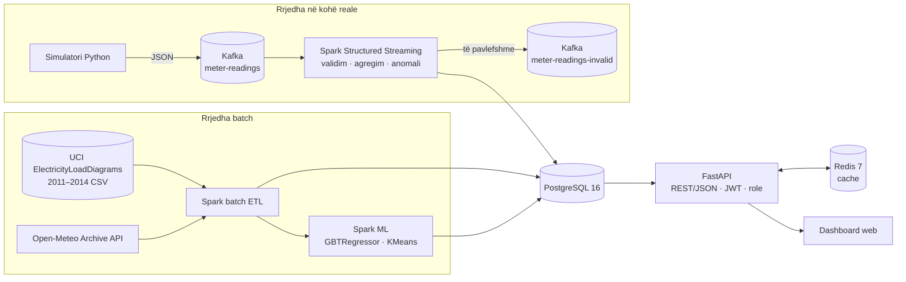

# Sistem për Monitorimin dhe Parashikimin e Konsumit të Energjisë Elektrike

Projekt për lëndën **Sistemet e procesimit të të dhënave dizajnuese**.

Sistemi merr në kohë reale leximet e matësve të energjisë elektrike, i validon, i agregon dhe zbulon anomalitë (Kafka + Spark Structured Streaming). Krahas kësaj, përpunon të dhënat historike të konsumit dhe të motit (Spark batch) për të parashikuar konsumin e 24 orëve të ardhshme dhe për të segmentuar konsumatorët. Rezultatet ofrohen përmes një API REST të sigurt dhe një dashboard-i web.

Kërkesat e plota: [docs/kerkesat.md](docs/kerkesat.md)

## Ekipi

| Anëtari | Përgjegjësia |
|---|---|
| Artor G | Marrja e të dhënave dhe infrastruktura |
| Yll N | Batch, ETL dhe ML |
| Yll K | DB, API, dashboard dhe CI/CD |

## Arkitektura



## Parakushtet

- [Docker](https://docs.docker.com/get-docker/) (Docker Desktop në Windows/macOS)
- Docker Compose v2 (`docker compose`)
- Bash (në Windows: Git Bash ose WSL) për `scripts/check_env.sh`
- Portet e lira në host: `5432` (PostgreSQL), `9092` (Kafka), `6379` (Redis) — mund të ndryshohen në `.env`

## Nisja

```bash
# 1. Krijo skedarin e konfigurimit dhe ndrysho fjalëkalimet
cp .env.example .env

# 2. Ngri shërbimet
docker compose up -d

# 3. Kontrollo që gjithçka është gati
./scripts/check_env.sh
```

Pas nisjes:

| Shërbimi | Nga host-i | Nga kontejnerët |
|---|---|---|
| PostgreSQL | `localhost:${POSTGRES_PORT}` | `postgres:5432` |
| Kafka | `localhost:${KAFKA_EXTERNAL_PORT}` | `kafka:29092` |
| Redis | `localhost:${REDIS_PORT}` | `redis:6379` |

Topic-et Kafka krijohen automatikisht nga kontejneri `kafka-init`:

| Topic | Particione | Replication factor |
|---|---|---|
| `meter-readings` | 3 | 1 |
| `meter-readings-invalid` | 1 | 1 |

Ndalimi: `docker compose down` (të dhënat ruhen në volume). Për fshirje të plotë të të dhënave: `docker compose down -v`.

> Skriptet SQL në `db/migrations/` ekzekutohen nga PostgreSQL vetëm në nisjen e parë (kur volume-i është bosh).

## Teknologjitë

| Teknologjia | Versioni | Përdorimi |
|---|---|---|
| Python | 3.11 | Simulatori, Spark jobs, API |
| Apache Kafka | 3.7.0 (KRaft, pa Zookeeper) | Transporti i leximeve në kohë reale |
| Apache Spark | 3.5 | Structured Streaming, ETL batch, MLlib |
| PostgreSQL | 16.4 | Ruajtja e të dhënave |
| Redis | 7.2.5 | Cache për API-n |
| FastAPI | — | REST API me JWT |
| Docker / Docker Compose | v2 | Mjedisi i zhvillimit |
| Kubernetes (minikube/kind) | — | Vendosja (faza e mëvonshme) |
| GitHub Actions | — | CI/CD |

## Struktura e dosjeve

```
.
├── .github/workflows/   # Pipeline-t CI/CD (GitHub Actions)
├── api/                 # FastAPI: endpoint-et, autentikimi JWT, cache Redis
├── batch/               # Spark batch: ETL i të dhënave historike dhe të motit
├── dashboard/           # Dashboard-i web
├── data/                # Të dhënat lokale (raw/ dhe features/ nuk futen në Git)
├── db/migrations/       # Skriptet SQL të skemës (ekzekutohen në nisjen e parë)
├── docs/                # Dokumentimi (kërkesat, dizajni)
├── k8s/                 # Manifestet Kubernetes
├── ml/                  # Trajnimi i modeleve (GBTRegressor, KMeans)
├── scripts/             # Skripte ndihmëse (check_env.sh)
├── simulator/           # Simulatori i matësve (Kafka producer)
├── streaming/           # Spark Structured Streaming
├── tests/               # Testet automatike
├── .env.example         # Shembull i variablave të mjedisit
└── docker-compose.yml   # Shërbimet e infrastrukturës
```
