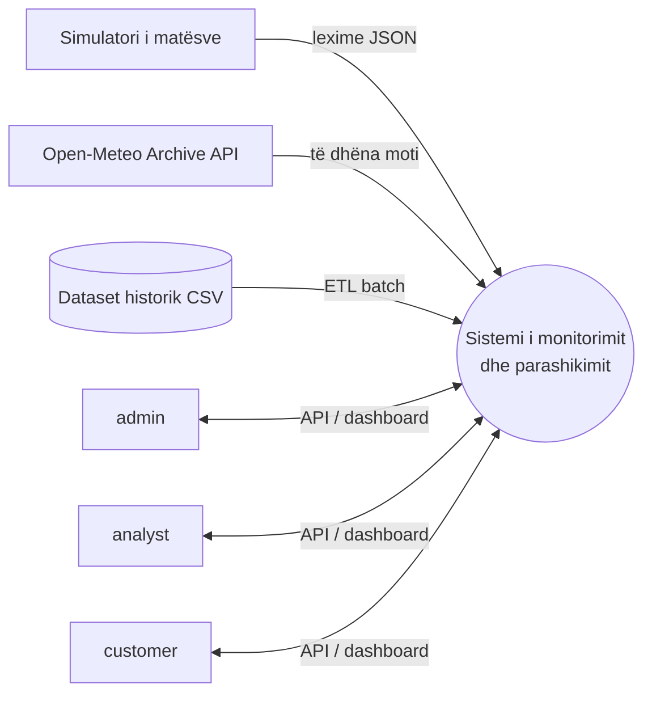

# Specifikimi i kërkesave

**Projekti:** Sistem për Monitorimin dhe Parashikimin e Konsumit të Energjisë Elektrike
**Lënda:** Sistemet e procesimit të të dhënave dizajnuese
**Ekipi:**

| Anëtari | Përgjegjësia |
|---|---|
| Artor G | Marrja e të dhënave (simulatori, Kafka) dhe infrastruktura (Docker, Kubernetes) |
| Yll N | Procesimi batch, ETL dhe Machine Learning (Spark) |
| Yll K | Baza e të dhënave, API, dashboard dhe CI/CD |

**Versioni i dokumentit:** 1.0

---

## 1. Përshkrimi i problemit, konteksti dhe objektivat

### 1.1 Konteksti

Shpërndarësit e energjisë elektrike dhe konsumatorët e mëdhenj kanë qindra deri në mijëra matës (smart meters) që gjenerojnë lexime të konsumit në intervale të shkurtra (p.sh. çdo 15 minuta). Këto të dhëna zakonisht mblidhen në mënyrë periodike (një herë në ditë ose në muaj) dhe analizohen me vonesë, pa u kombinuar me faktorë të jashtëm si moti.

### 1.2 Problemi

1. **Konsumi nuk monitorohet në kohë reale.** Leximet përpunohen me vonesë prej orësh ose ditësh, prandaj ngarkesat e larta dhe sjelljet e pazakonta vihen re vonë.
2. **Gabimet e matësve nuk kapen.** Lexime negative, vlera ekstreme, kohë të gabuara, lexime të dyfishta ose matës që ndalojnë së dërguari të dhëna nuk zbulohen automatikisht dhe ndotin raportet.
3. **Konsumi nuk parashikohet.** Mungon një parashikim i konsumit për orët në vijim, gjë që e vështirëson planifikimin e ngarkesës dhe të blerjes së energjisë.

### 1.3 Objektivat

| ID | Objektivi |
|---|---|
| O-1 | Marrja dhe përpunimi i leximeve të matësve në kohë reale (nga dërgimi deri në bazën e të dhënave brenda 30 s). |
| O-2 | Validimi automatik i çdo leximi, ruajtja e leximeve të pavlefshme me arsyen e refuzimit dhe zbulimi i anomalive. |
| O-3 | Ndërtimi i një procesi ETL batch që bashkon të dhënat historike të konsumit me të dhënat e motit. |
| O-4 | Parashikimi i konsumit për 24 orët e ardhshme për çdo matës dhe segmentimi i konsumatorëve sipas profilit. |
| O-5 | Ofrimi i të dhënave përmes një API të sigurt (JWT, role) dhe një dashboard-i web për përdoruesit. |
| O-6 | Sistem i riprodhueshëm që ngrihet me një komandë dhe testohet automatikisht (CI/CD). |

---

## 2. Aktorët dhe rolet

### 2.1 Aktorët njerëzorë

| Aktori | Përshkrimi | Të drejtat |
|---|---|---|
| **admin** | Administratori i sistemit. | Qasje e plotë: lexim i të gjitha të dhënave, menaxhim i përdoruesve dhe i matësve, konfigurim i pragjeve të alarmeve, nisje e proceseve batch/ML, menaxhim i alarmeve. |
| **analyst** | Analist i konsumit të energjisë. | **Vetëm lexim** i të gjitha të dhënave: leximet, agregimet, alarmet, parashikimet dhe segmentet për të gjithë matësit. Nuk mund të ndryshojë të dhëna. |
| **customer** | Konsumator (klient) që zotëron një ose më shumë matës. | Vetëm lexim i të dhënave të **matësve të vet** (konsumi, parashikimi, alarmet). Çdo kërkesë për matës të tjetërkujt refuzohet. |

### 2.2 Sistemet e jashtme

| Sistemi | Roli | Ndërfaqja |
|---|---|---|
| **Simulatori i matësve** | Gjeneron lexime realiste konsumi (bazuar në profilet e dataset-it historik) për një bashkësi matësish dhe i dërgon në Kafka. Mund të injektojë qëllimisht lexime të gabuara dhe anomali për testim. | Kafka producer → topic `meter-readings` (JSON). |
| **Open-Meteo Archive API** | Burim i të dhënave historike të motit (temperatura, lagështia etj.) për periudhën dhe vendndodhjen e dataset-it. | HTTP REST/JSON, pa çelës API. |

### 2.3 Diagrami i kontekstit



---

## 3. Kërkesat funksionale

Çdo kërkesë ka një ID unike, përshkrim, prioritet (MoSCoW: **M** = Must, **S** = Should) dhe kritere pranimi të testueshme.

Formati i një leximi në Kafka (referencë për kërkesat më poshtë):

```json
{ "meter_id": "MT_001", "ts": "2026-11-23T10:15:00Z", "kwh": 0.42 }
```

### KF-01 Marrja e leximeve në kohë reale nga Kafka

- **Përshkrimi:** Sistemi lexon vazhdimisht leximet e matësve nga topic-u Kafka `meter-readings` me Spark Structured Streaming.
- **Prioriteti:** M
- **Kriteret e pranimit:**
  1. Kur simulatori dërgon N lexime të vlefshme, të N leximet shfaqen në tabelën e leximeve në PostgreSQL.
  2. Streaming-u lexon nga të 3 particionet e topic-ut `meter-readings`.
  3. Mesazhet me JSON të keqformuar nuk e ndalojnë procesin; trajtohen sipas KF-03.

### KF-02 Validimi i leximeve

- **Përshkrimi:** Çdo lexim kontrollohet sipas rregullave të validimit para se të ruhet si i vlefshëm.
- **Prioriteti:** M
- **Rregullat:**

  | Kodi | Rregulli |
  |---|---|
  | V1 | Fushat e detyrueshme `meter_id`, `ts`, `kwh` ekzistojnë dhe nuk janë `null`. |
  | V2 | `kwh` është numër dhe `kwh ≥ 0`. |
  | V3 | `kwh` është nën kufirin maksimal të konfiguruar për një interval (p.sh. 100 kWh / 15 min). |
  | V4 | `ts` nuk është në të ardhmen (lejohet devijim i orës deri në 5 minuta). |
  | V5 | `meter_id` ekziston në regjistrin e matësve në bazën e të dhënave. |

- **Kriteret e pranimit:**
  1. Një lexim që plotëson V1–V5 ruhet si i vlefshëm.
  2. Për secilin rregull V1–V5 ekziston të paktën një test me lexim që e shkel vetëm atë rregull, dhe leximi refuzohet me kodin përkatës.
  3. Leximet e refuzuara nuk shfaqen në tabelën e leximeve të vlefshme as në agregime.

### KF-03 Ruajtja e leximeve të pavlefshme dhe heqja e duplikateve

- **Përshkrimi:** Leximet që dështojnë validimin ruhen veçmas, bashkë me arsyen e refuzimit, dhe publikohen në topic-un `meter-readings-invalid`. Leximet e dyfishta eliminohen.
- **Prioriteti:** M
- **Kriteret e pranimit:**
  1. Çdo lexim i refuzuar ruhet në tabelën e leximeve të pavlefshme me përmbajtjen origjinale, kodin/arsyen e refuzimit dhe kohën e procesimit.
  2. Çdo lexim i refuzuar publikohet edhe në topic-un `meter-readings-invalid`.
  3. Dy lexime me të njëjtin çelës (`meter_id`, `ts`) ruhen vetëm një herë: pas dërgimit të të njëjtit lexim 2 herë, numri i rreshtave për atë çelës në DB është 1.

### KF-04 Agregimi i konsumit për orë

- **Përshkrimi:** Sistemi llogarit konsumin total për çdo orë dhe për çdo matës (dritare kohore 1-orëshe me watermark për të dhëna të vonuara).
- **Prioriteti:** M
- **Kriteret e pranimit:**
  1. Për 4 lexime të një matësi brenda së njëjtës orë me vlera 0.1, 0.2, 0.3, 0.4 kWh, agregati i asaj ore është 1.0 kWh.
  2. Agregati përmban `meter_id`, fillimin e orës, totalin kWh dhe numrin e leximeve.
  3. Leximet e vonuara brenda kufirit të watermark-ut (p.sh. 1 orë) përfshihen në orën e duhur.

### KF-05 Zbulimi i anomalive dhe alarmet

- **Përshkrimi:** Sistemi gjeneron alarme për (a) konsum anomal dhe (b) matës që nuk dërgojnë të dhëna.
- **Prioriteti:** M
- **Rregullat:**
  - **Anomali konsumi:** z-score = (x − μ) / σ, ku μ dhe σ janë mesatarja dhe devijimi standard i profilit historik të matësit për të njëjtën orë të ditës (dhe ditë të javës). Nëse |z| > 3 krijohet alarm i tipit `ANOMALY`.
  - **Matës i heshtur:** nëse një matës aktiv nuk ka asnjë lexim për më shumë se 1 orë, krijohet alarm i tipit `NO_DATA`.
- **Kriteret e pranimit:**
  1. Një lexim me z-score = 4 ndaj profilit krijon saktësisht një alarm `ANOMALY` me `meter_id`, kohën, vlerën dhe z-score-in.
  2. Një lexim me z-score = 2 nuk krijon alarm.
  3. Një matës pa lexime për 61 minuta gjeneron alarm `NO_DATA`; një matës me lexim 50 minuta më parë nuk gjeneron.
  4. Alarmet shfaqen në API dhe në dashboard (KF-10).

### KF-06 Ngarkimi i të dhënave historike dhe të motit (ETL batch)

- **Përshkrimi:** Një proces Spark batch lexon dataset-in historik CSV (UCI ElectricityLoadDiagrams20112014), merr të dhënat e motit nga Open-Meteo Archive API, i pastron, i transformon (nga format i gjerë në format i gjatë, 15 min → orë) dhe i ngarkon në PostgreSQL. Gjeneron edhe veçoritë (features) për ML.
- **Prioriteti:** M
- **Kriteret e pranimit:**
  1. Pas ekzekutimit, numri i matësve në DB përputhet me numrin e kolonave të matësve në CSV.
  2. Nuk ka orë të dyfishta për asnjë matës; vlerat që mungojnë trajtohen sipas një rregulli të dokumentuar.
  3. Për çdo orë të periudhës ekziston rreshti përkatës i motit (temperatura).
  4. Ri-ekzekutimi i ETL-së nuk krijon duplikate (procesi është idempotent).

### KF-07 Parashikimi i konsumit për 24 orët e ardhshme

- **Përshkrimi:** Një model GBTRegressor (Spark MLlib), i trajnuar me veçori kohore (ora, dita e javës, muaji, festat), konsum i mëparshëm (lag) dhe të dhëna moti, parashikon konsumin orë për orë për 24 orët e ardhshme për çdo matës.
- **Prioriteti:** M
- **Kriteret e pranimit:**
  1. Për çdo matës aktiv ruhen 24 vlera parashikimi (një për çdo orë) me kohën e gjenerimit dhe versionin e modelit.
  2. Modeli vlerësohet në një periudhë testimi të ndarë kronologjikisht; raportohen MAE, RMSE dhe MAPE.
  3. Modeli është më i mirë (MAE më i ulët) se modeli bazë naiv "e njëjta orë javën e kaluar".
  4. Parashikimet janë të qasshme përmes API-t.

### KF-08 Segmentimi i konsumatorëve

- **Përshkrimi:** Konsumatorët grupohen me KMeans sipas profilit të normalizuar të konsumit (profili mesatar 24-orësh, raporti ditë pune/fundjavë, sezonaliteti).
- **Prioriteti:** S
- **Kriteret e pranimit:**
  1. Çdo matës ka saktësisht një segment të caktuar.
  2. Numri i segmenteve k zgjidhet me metodë të dokumentuar (p.sh. silhouette score) dhe vlera e silhouette ruhet.
  3. Për çdo segment ruhet profili qendror (centroidi) dhe numri i matësve.

### KF-09 Autentikimi dhe autorizimi

- **Përshkrimi:** API-ja kërkon autentikim me JWT dhe zbaton kontroll qasjeje sipas roleve `admin`, `analyst`, `customer`.
- **Prioriteti:** M
- **Kriteret e pranimit:**
  1. Login me kredenciale të sakta kthen një JWT me afat skadimi; me kredenciale të gabuara kthen `401`.
  2. Kërkesa pa token ose me token të skaduar/të falsifikuar kthen `401`.
  3. `analyst` që tenton një operacion shkrimi merr `403`.
  4. `customer` që kërkon të dhëna të një matësi që nuk i përket merr `403` (ose `404`), dhe listat i kthejnë vetëm matësit e vet.
  5. `admin` ka qasje në të gjitha endpoint-et.

### KF-10 Dashboard-i

- **Përshkrimi:** Një ndërfaqe web që shfaq gjendjen e konsumit dhe alarmet, me të dhëna nga API-ja.
- **Prioriteti:** M
- **Kriteret e pranimit:**
  1. Shfaq KPI: konsumi total sot, pika maksimale (peak), numri i matësve aktivë, numri i alarmeve të hapura.
  2. Shfaq grafikë: konsumi për orë (aktual) bashkë me parashikimin 24-orësh, dhe shpërndarjen sipas segmenteve.
  3. Ka filtra sipas matësit, rajonit dhe periudhës; ndryshimi i filtrit përditëson KPI-të dhe grafikët.
  4. Shfaq listën e alarmeve (tipi, matësi, koha, vlera), të renditura nga më i riu.
  5. Përdoruesi `customer` sheh vetëm matësit e vet.

---

## 4. Kërkesat jofunksionale

| ID | Kategoria | Kërkesa | Vlera e matshme | Mënyra e matjes |
|---|---|---|---|---|
| **KJF-01** | Performanca | Koha e përgjigjes së API-t për endpoint-et e dashboard-it. | p95 ≤ 200 ms (me cache Redis, 20 përdorues të njëkohshëm, mjedis lokal) | Test ngarkese (p.sh. Locust/k6), 5 minuta. |
| **KJF-02** | Performanca | Vonesa nga dërgimi i leximit deri në shfaqjen në DB. | ≤ 30 s për ≥ 95% të leximeve | Krahasimi i kohës së dërgimit me kohën e insertimit në DB. |
| **KJF-03** | Siguria | (a) Të gjitha pyetjet SQL janë të parametrizuara; (b) fjalëkalimet ruhen me bcrypt; (c) asnjë sekret në kod/Git, gjithçka nga `.env` / Secrets; (d) gabimet kthehen pa stack trace. | 0 pyetje me string concatenation; 0 sekrete në repo; 0 stack trace në përgjigjet HTTP | Code review, skanim i sekreteve në CI, teste për SQL injection dhe për formatin e gabimeve. |
| **KJF-04** | Besueshmëria | Rinisja e streaming-ut pa humbje dhe pa duplikate (checkpoint + upsert sipas çelësit). | 0 lexime të humbura, 0 duplikate pas rinisjes | Test: ndalim i job-it gjatë dërgimit, rinisje, krahasim i numrit të dërguar me numrin në DB. |
| **KJF-05** | Mirëmbajtshmëria | Strukturë modulare (një dosje për çdo komponent), teste automatike në CI. | Mbulim i testeve ≥ 70% për API-n; CI kalon në çdo push | `pytest --cov`, GitHub Actions. |
| **KJF-06** | Riprodhueshmëria | Sistemi ngrihet në një makinë të re me një komandë. | `docker compose up -d` → të gjitha shërbimet `healthy` pa hapa manualë (përveç `cp .env.example .env`) | `scripts/check_env.sh` printon OK për çdo kontroll. |

---

## 5. Tabela e gjurmueshmërisë

| ID | Komponenti | Mënyra e verifikimit (lloji i testit) |
|---|---|---|
| KF-01 | `simulator/`, Kafka, `streaming/` | Test integrimi: dërgim i N leximeve → numërim në PostgreSQL. |
| KF-02 | `streaming/` (moduli i validimit) | Teste njësie për çdo rregull V1–V5 (pytest me Spark lokal). |
| KF-03 | `streaming/`, Kafka (`meter-readings-invalid`), `db/` | Test integrimi: lexime të pavlefshme dhe të dyfishta → kontroll i tabelave dhe topic-ut. |
| KF-04 | `streaming/` (agregimi), `db/` | Test njësie me të dhëna të njohura; test integrimi për të dhëna të vonuara. |
| KF-05 | `streaming/` (anomalitë), `batch/` (profilet), `db/` | Teste njësie për z-score; test integrimi për `NO_DATA`. |
| KF-06 | `batch/`, Open-Meteo, `db/` | Test integrimi i ETL-së në një nëngrup të dataset-it; kontrolle të cilësisë së të dhënave; test idempotence. |
| KF-07 | `ml/`, `db/`, `api/` | Vlerësim offline i modelit (MAE/RMSE/MAPE vs. modeli bazë); test i API-t për parashikimet. |
| KF-08 | `ml/`, `db/` | Vlerësim offline (silhouette); test që çdo matës ka një segment. |
| KF-09 | `api/` (auth) | Teste API (pytest + TestClient) për 401/403 sipas rolit. |
| KF-10 | `dashboard/`, `api/` | Test end-to-end / manual sipas listës së kontrollit; teste API për endpoint-et e dashboard-it. |
| KJF-01 | `api/`, Redis | Test ngarkese (Locust/k6). |
| KJF-02 | `simulator/`, Kafka, `streaming/`, `db/` | Test i vonesës end-to-end. |
| KJF-03 | `api/`, `db/`, CI | Code review, skanim i sekreteve, teste sigurie. |
| KJF-04 | `streaming/` (checkpoint), `db/` | Test rinisjeje (chaos test). |
| KJF-05 | Të gjitha, CI | Raporti i mbulimit në GitHub Actions. |
| KJF-06 | `docker-compose.yml`, `scripts/` | Ekzekutimi i `scripts/check_env.sh` pas `docker compose up -d`. |

---

## 6. Kufizimet dhe supozimet

### 6.1 Kufizimet

- **Të dhënat historike** vijnë nga dataset-i UCI *ElectricityLoadDiagrams20112014*: 370 klientë në Portugali, lexime çdo 15 minuta (në kW), periudha 2011–2014. Disa klientë kanë vlera zero në fillim (nuk ishin ende klientë), gjë që trajtohet në ETL.
- **Dataset-i nuk përmban** vendndodhjen, rajonin apo tipin e klientit; rajonet u caktohen matësve në mënyrë sintetike për qëllime të filtrave në dashboard.
- **Të dhënat e motit** merren për një vendndodhje përfaqësuese në Portugali (p.sh. Lisbona), sepse vendndodhja e saktë e klientëve nuk dihet.
- **Matësit në kohë reale janë të simuluar**; nuk ka lidhje me matës fizikë.
- **Mjedisi është lokal** (Docker Compose, minikube/kind) me një nyje Kafka (replication factor 1), prandaj nuk ka tolerancë ndaj dështimit të nyjes.
- Versionet: Python 3.11, Spark 3.5, Kafka 3.7 (KRaft), PostgreSQL 16, Redis 7.

### 6.2 Supozimet

- Ora e sistemit të simulatorit dhe e serverit janë të sinkronizuara (devijim ≤ 5 min).
- Leximet e simulatorit ndjekin profilet e dataset-it historik, prandaj modeli i trajnuar mbi të dhënat historike është i zbatueshëm.
- Open-Meteo Archive API është e qasshme gjatë ekzekutimit të ETL-së; të dhënat e shkarkuara ruhen lokalisht për ri-ekzekutime.
- Çdo `customer` është i lidhur me një ose më shumë matës në bazën e të dhënave.
- Ngarkesa e pritshme në mjedisin lokal: deri në 400 matës × 1 lexim / 15 s në modalitet të përshpejtuar.
